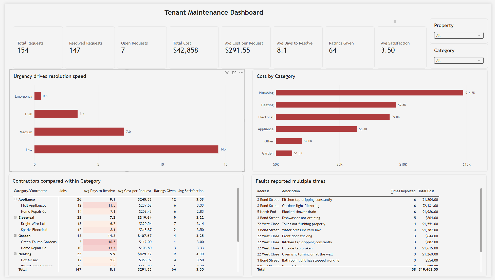

# Tenant Maintenance Analysis (SQL Server)

A SQL Server project that takes a messy export of tenant maintenance requests, cleans it into a small relational schema, and analyses where time and money go across three rental properties.

**Skills shown:** T-SQL, relational schema design (primary and foreign keys, lookup tables), data cleaning and validation, CTEs, window functions (`ROW_NUMBER`, `RANK`, `LAG`), reproducible scripts, Power BI (data modelling, DAX measures, dashboard design).

> **The data is synthetic.** `Tenant_Request_Raw_Data.csv` is dummy data modelled on a property-management request form. It contains no real tenants or addresses.



---

## The data

158 maintenance requests across 3 properties (Jan to Nov 2026), exported from a form. Each row has the address, issue category, urgency, description, dates, contractor, cost and an optional satisfaction rating.

The export is deliberately realistic and messy. See [Data quality issues](#data-quality-issues-and-how-they-were-handled).

## Schema

```
properties (property_id PK, address)
contractors (contractor_id PK, contractor_name)
statuses (status_id PK, status_name)
requests (request_id PK, property_id FK, contractor_id FK, status_id FK,
          issue_category, urgency, description, contact_preference,
          submitted_at, date_noticed, date_resolved, satisfaction, cost_nzd)
```

Raw data lands in a text-only staging table (`dbo.requests_raw`) that mirrors the CSV exactly. All typing and cleaning is done in SQL, so every transformation is visible and repeatable.

## How to run

Requires SQL Server (Express is fine) and SSMS.

1. Copy `data/Tenant_Request_Raw_Data.csv` to `C:\Temp\` (or edit the path in script 01). The SQL Server service account must be able to read the file.
2. Run `sql/01_setup_and_stage.sql`: creates the database and staging table and loads the CSV. Rerunning wipes and reloads staging.
3. Run `sql/02_clean_and_load.sql`: builds the clean schema and loads it. Safe to rerun. Check the sanity-check output at the end (expected values are in the comments).
4. Run `sql/03_analysis.sql`: the analysis queries.

## Data quality issues and how they were handled

| Issue | Handling |
|---|---|
| 12 spellings of 3 addresses ("3 Bond Stret", "22 Wset Close", "5 N End"...) | Pattern-matched into a `properties` lookup table |
| 4 duplicate submissions (same property, category, description and date, submitted minutes apart) | Removed with `ROW_NUMBER()`, keeping the earliest. 158 raw rows become 154 |
| 4 requests with no "date noticed" | Fall back to the submission date |
| Dates exported as `dd/mm/yyyy` | Converted with explicit style 103, so results don't depend on server language settings |
| One cost stored as `1,022` (thousands separator) | Commas stripped before conversion |
| 7 open requests (no resolved date or cost) | Kept, but excluded from resolution-time and cost metrics |
| 94 of 158 requests have no satisfaction rating | Left as `NULL`. Queries show `ratings_given` so sample size is visible |

### Two failures that were silent

Both were caught by checking results rather than by errors, because `TRY_CONVERT` returns `NULL` instead of failing:

- **Date format.** Reading `dd/mm/yyyy` dates under a US-style setting turned any date with a day over 12 into `NULL` and quietly swapped day and month on the rest. It showed up as 128 clean rows instead of 154, and was fixed by specifying the format explicitly.
- **Thousands separator.** The `1,022` cost became `NULL` and dropped out of every sum. It was found by reconciling category and property totals against an earlier run, and a check now confirms every resolved job has a cost.

**Assumption:** two requests with the same property, category, description and date noticed count as one. All four duplicates found were submitted within a minute of each other with identical costs, so these look like accidental double submissions. This would be wrong if a tenant legitimately reported the same fault twice in a day.

## Findings

### 1. Urgency drives resolution speed more than anything else

| Urgency | Resolved | Avg days to resolve |
|---|---|---|
| Emergency | 10 | 0.5 |
| High | 31 | 3.4 |
| Medium | 60 | 7.0 |
| Low | 46 | 14.4 |

Low-urgency jobs wait over two weeks on average, compared with under a day for emergencies. This matters for every comparison below: a category or contractor that mostly gets low-urgency work will look slow regardless of quality.

### 2. Plumbing costs the most, garden jobs are the slowest and cheapest

| Category | Resolved | Avg days | Total cost |
|---|---|---|---|
| Plumbing | 45 | 6.3 | $14,737 |
| Heating | 22 | 5.9 | $9,445 |
| Electrical | 28 | 7.2 | $8,950 |
| Appliance | 26 | 9.1 | $6,385 |
| Other | 14 | 12.4 | $2,049 |
| Garden | 12 | 14.2 | $1,292 |

### 3. The busiest property isn't the one with the costliest problems

| Property | Requests | Total cost | Avg cost per request |
|---|---|---|---|
| 3 Bond Street | 62 | $16,625 | $277.08 |
| 22 West Close | 50 | $13,387 | $297.49 |
| 5 North End | 42 | $12,846 | $305.86 |

3 Bond Street has the most requests and the highest total spend, but North End's individual repairs cost more on average.

### 4. A naive contractor comparison points to the wrong conclusion

Ranked on overall average resolution time, Home Repair Co looks like one of the slower contractors. Compared **within each category** (query 5, using `RANK() OVER (PARTITION BY ...)`), it is the fastest contractor in all three categories where it has a competitor:

| Category | Home Repair Co | Competitor |
|---|---|---|
| Appliance | 7.1 days | 11.5 days (FixIt Appliances) |
| Garden | 13.7 days | 16.5 days (Green Thumb Gardens) |
| Other | 10.4 days | 15.2 days (Handy Services) |

It only looked slow because it takes most of the garden and odd jobs, which are slow for everyone. Comparing like with like reverses the conclusion.

### 5. Heating has a real cost versus quality trade-off

| Contractor | Jobs | Avg days | Avg cost | Avg rating (ratings) |
|---|---|---|---|---|
| Hot Air inc | 12 | 5.6 | $358.92 | 3.5 (4) |
| WarmHome Heating | 10 | 6.3 | $513.80 | 4.4 (5) |

WarmHome costs about $155 more per job and takes under a day longer, but is rated higher. Ratings are few, so this is a prompt for a decision, not a verdict.

### 6. Some faults keep coming back

Faults reported repeatedly at the same property (query 6):

| Property | Fault | Times reported | Total cost |
|---|---|---|---|
| 3 Bond Street | Outdoor light flickering | 6 | $2,131 |
| 5 North End | Blocked shower drain | 6 | $1,986 |
| 3 Bond Street | Kitchen tap dripping constantly | 6 | $1,804 |

Roughly $2,000 each spent on repeat call-outs for one fault may suggest a proper repair or replacement would be cheaper.

### 7. Most repeat faults return weeks later, not days later

Of 66 repeat reports of the same fault at the same property, 5 were logged before the previous job had been resolved. Of the 61 that came after a job was closed, 11 (18%) returned within two weeks and 21 (34%) within 30 days. The median gap after a fix is 53 days (query 7, using `LAG` on the resolution date).

The pattern points to recurring underlying causes more than to repairs failing straight away. The clearest exception is the outdoor light at 3 Bond Street: a job resolved on 20 September was followed by another report five days later, and another the day after that.

## Power BI dashboard

The clean tables are also reported on in Power BI: `powerbi/tenant-maintenance-dashboard.pbix`. It connects to the `TenantMaintenance` database in Import mode, loading only `requests`, `properties`, `contractors` and `statuses` (never the staging table). To refresh it against your own instance, change the data source to your server name.

**What it shows**
- KPI cards: total requests, resolved and open requests, total cost, average cost per request, average days to resolve, ratings given and average satisfaction.
- Average days to resolve by urgency (finding 1).
- Total cost by category, with average days to resolve in the tooltip (finding 2).
- A matrix comparing contractors within each category, with `Ratings Given` kept visible so small samples are obvious (findings 4 and 5).
- A table of faults reported three or more times (finding 6).
- Slicers for property and category.

**Reconciliation with the SQL.** The dashboard's measures are checked against the SQL results: 154 requests (147 resolved, 7 open), $42,858 total cost, $291.55 average cost, 8.1 average days to resolve, urgency averages of 0.5 / 3.4 / 7.0 / 14.4, and the contractor matrix rows match query 5.

**One extra figure from the dashboard.** The 15 faults reported three or more times account for 58 of the 154 requests (38%) and $19,462 of the $42,858 spend (45%). This comes from the table's total row, not from a SQL query.

**Two modelling notes**
- Measures are written in DAX over the relationships created by the foreign keys. For example:

```dax
Resolved Requests =
CALCULATE(COUNTROWS(requests), requests[date_resolved] <> BLANK())

Avg Days to Resolve =
AVERAGEX(
    FILTER(requests, NOT ISBLANK(requests[date_resolved])),
    DATEDIFF(requests[date_noticed], requests[date_resolved], DAY)
)
```

- The urgency sort order (Emergency, High, Medium, Low) is a column added in Power Query. Building it as a DAX calculated column caused a circular dependency when used to sort `urgency`.

The `.pbix` can't be previewed on GitHub, so the screenshot at the top of this README shows the finished page. The file contains only the synthetic data.

## Limitations and next steps

- Small sample: some contractor and category combinations have only 1 or 2 jobs, and most requests have no rating. Treat those ranks with care.
- Contractor comparisons are within category but not within urgency. Comparing within both would be fairer.
- Real data would need a fault-type field or fuzzy matching to track recurring faults reliably.
- Resolution time is measured from "date noticed", not from when the landlord was told, and in whole days, so a same-day fix counts as 0.
- Repeat faults are matched on description text (case-insensitive), so differently worded reports of the same fault are missed and the repeat counts are probably an underestimate.

## Repository layout

```
├── README.md
├── data/
│   └── Tenant_Request_Raw_Data.csv
├── sql/
│   ├── 01_setup_and_stage.sql
│   ├── 02_clean_and_load.sql
│   └── 03_analysis.sql
├── powerbi/
│   └── tenant-maintenance-dashboard.pbix
└── screenshots/
    └── dashboard.png
```
